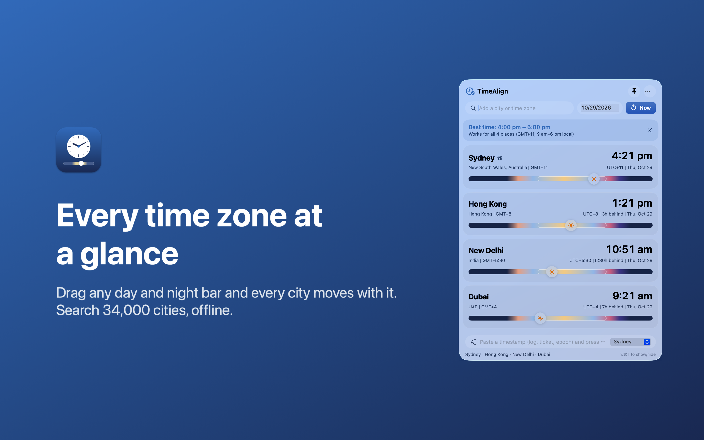

# TimeAlign

A macOS menu bar app for engineers who work with timestamps: decode them, line logs up across
time zones, and compare zones at a glance. Everything runs on your Mac; nothing is sent anywhere.



**Workbench** (developer tools)
- **Inspect**: paste any timestamp, epoch (s, ms, µs, ns) or time-based ID (UUIDv1/v6/v7, ULID,
  Snowflake, MongoDB ObjectId). See what it was read as, warnings worth checking (epoch unit,
  day/month order, missing or ambiguous zone, times a clock change skips or repeats), the instant in
  every zone, and copy it as ISO 8601, RFC 3339, epoch, SQL, HTTP date, Slack, Discord, JavaScript
  or Python.
- **Logs**: paste lines from several systems, each with the zone to assume when a line has none. Get
  one merged timeline in the zone you pick, with the gap between events and the longest gap marked.
  Copy it as a Markdown table for a postmortem or as a normalized log.
- **Cron**: a cron expression in plain English, its next runs in every zone, and the runs a clock
  change moves or skips.
- **Services menu**: select text in any app, then Services > Inspect Timestamp in TimeAlign or Add Logs
  to TimeAlign Timeline.
- **Shortcuts**: Convert Timestamp, Build Timeline from Logs and Inspect in TimeAlign actions.

**Zones**
- Add any of ~34,000 cities, a zone abbreviation (PST, IST, BST) or an IANA zone (Europe/Lisbon).
- Drag the day/night bar on any row and every row moves together.
- "Best time" banner finds the overlap of everyone's working hours.
- Lives in the menu bar (shows UTC); Option-Command-T shows or hides the panel, Command-1 and
  Command-2 switch tabs.

## Install

1. Download `TimeAlign-<version>.dmg` from the [latest release](../../releases/latest).
2. Open it and drag **TimeAlign** onto **Applications**.
3. Launch TimeAlign from Applications. There's no Dock icon: look for the globe and UTC time in
   the menu bar.

Requires macOS 13 or later. Runs on Apple Silicon and Intel Macs.

## Build from source

```bash
./build.sh            # build, install to /Applications and launch
swift test            # parser, ID, log timeline and cron tests
./release.sh 1.2      # universal, signed, notarized DMG in build/ (needs a Developer ID)
./appstore.sh 1.2 4   # sandboxed Mac App Store .pkg (needs App Store certificates and profile)
```

## Credits

City data from [GeoNames](https://www.geonames.org), licensed under
[CC BY 4.0](https://creativecommons.org/licenses/by/4.0/). See `Resources/README.md`.

Code is MIT licensed; see `LICENSE`.
